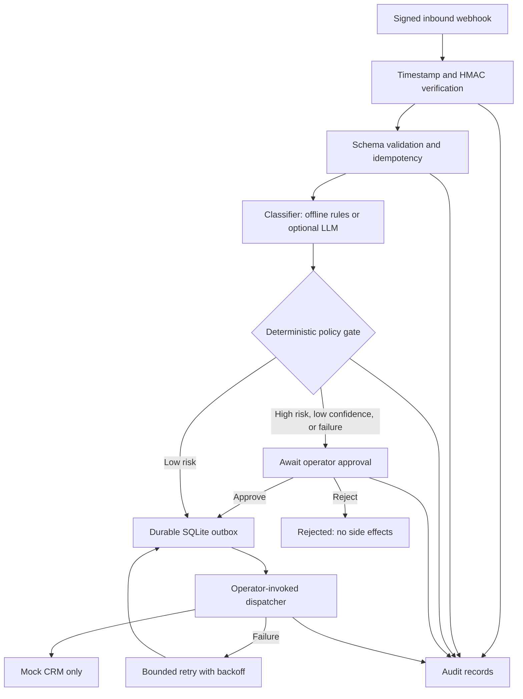

# Architecture and trust boundaries

## Behavior and constraints

- Inbound requests must provide `X-Webhook-Timestamp`, `X-Webhook-Signature` (`sha256=<digest>`), and `Idempotency-Key` headers. The signature covers `timestamp + '.' + idempotency_key + '.' + raw_body`.
- Requests more than five minutes outside the server's clock are rejected. Retries with the same idempotency key and same validated payload reuse the existing workflow; conflicts get HTTP 409.
- The classifier produces a *recommendation*, not an execution authorization. Deterministic policy forces review for high-urgency, high-impact or low-confidence requests and classification failures.
- Operator actions require a separate bearer token; approvals and rejections are recorded in the audit trail.
- The outbox uses SQLite transactions and leases to minimize duplicate claims. Failed dispatch attempts get exponential backoff, capped at three attempts; the sample downstream is a memory-only mock and has no external network effects.
- Original messages are not written to SQLite. Only a validated reference, limited classification fields and non-sensitive audit details are retained.
- Health and API responses intentionally do not include secrets or raw payloads.

## Production gaps (intentionally out of scope)

This is **not a production SaaS**. A real deployment needs managed secrets, TLS termination, centralized identity/RBAC, request throttling, observability, backups, a robust poison-message/dead-letter strategy, retention/deletion controls, and a real CRM connector with an external idempotency contract. The outbox worker would need a unique lease token/fencing so that a timed-out worker cannot complete another worker's claim. Demonstration PII redaction does not replace professional data-loss prevention. Model reliability must be validated against a representative dataset before any use in a real business process.
